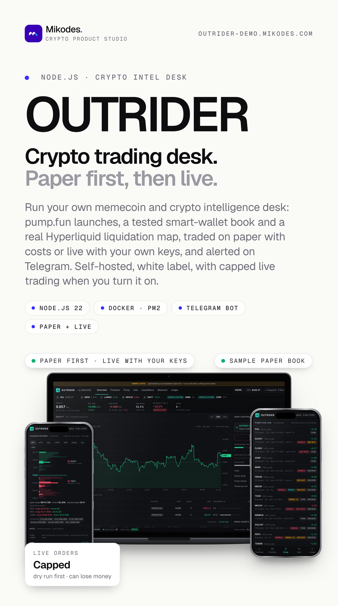
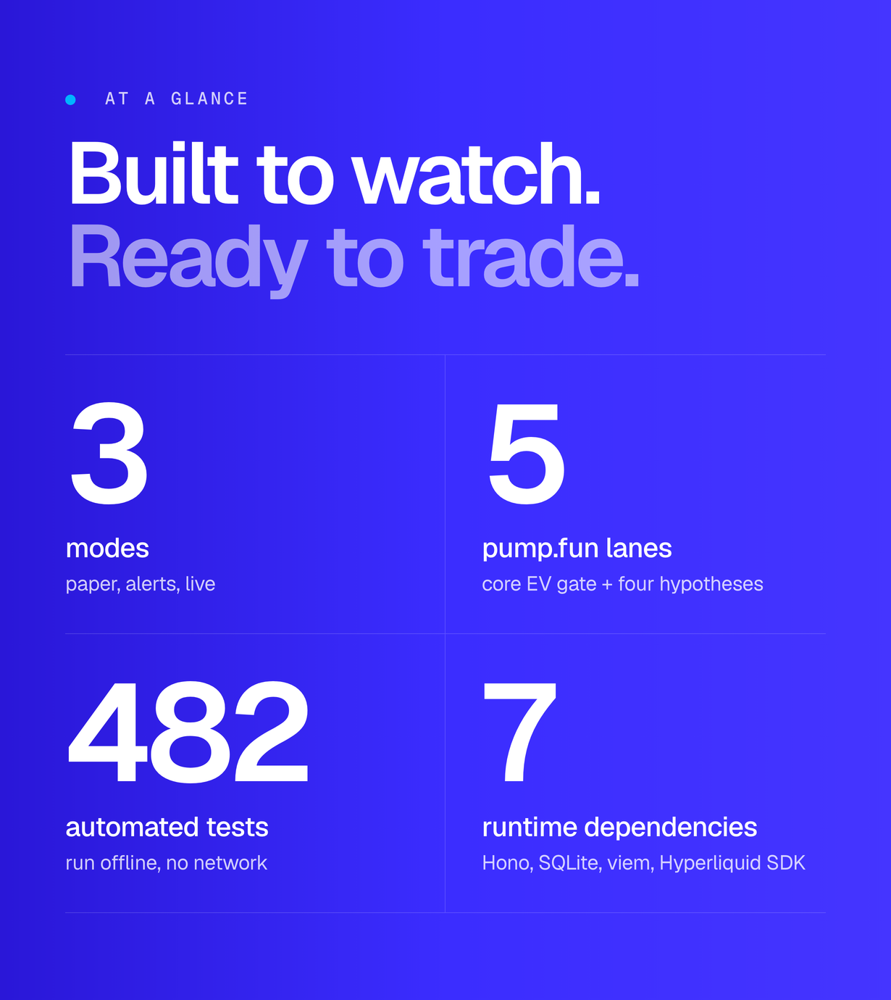
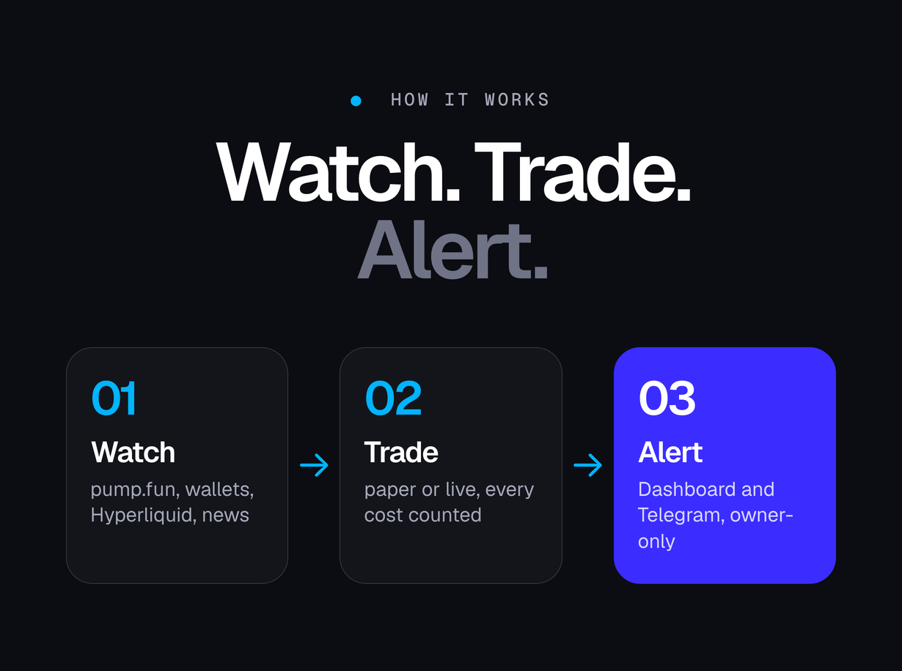
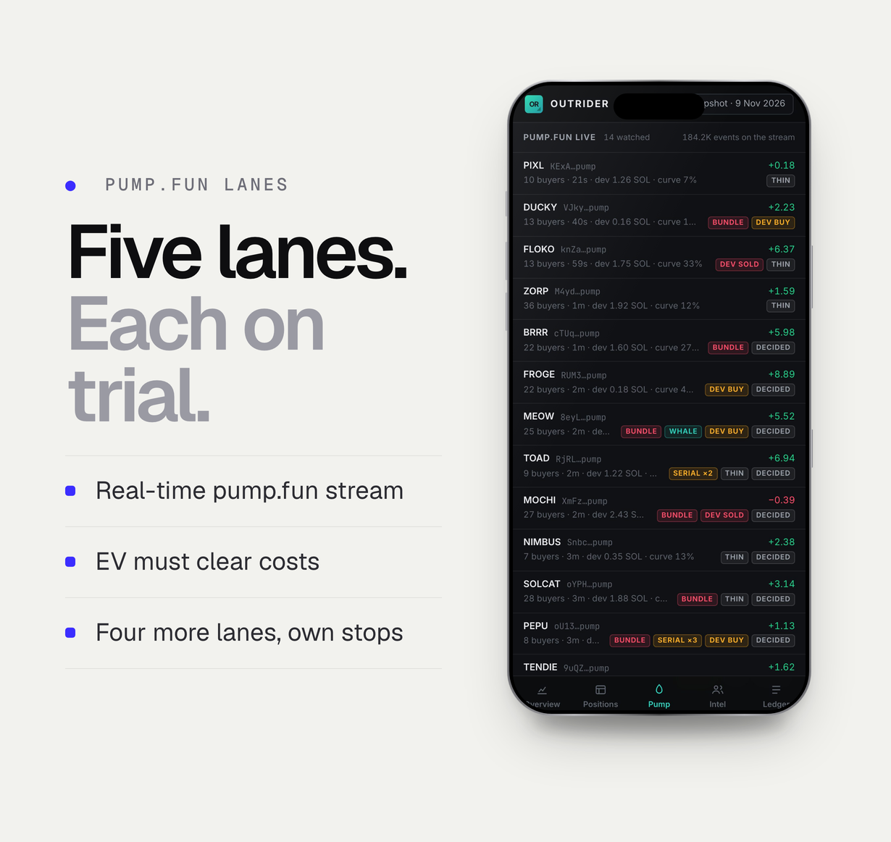
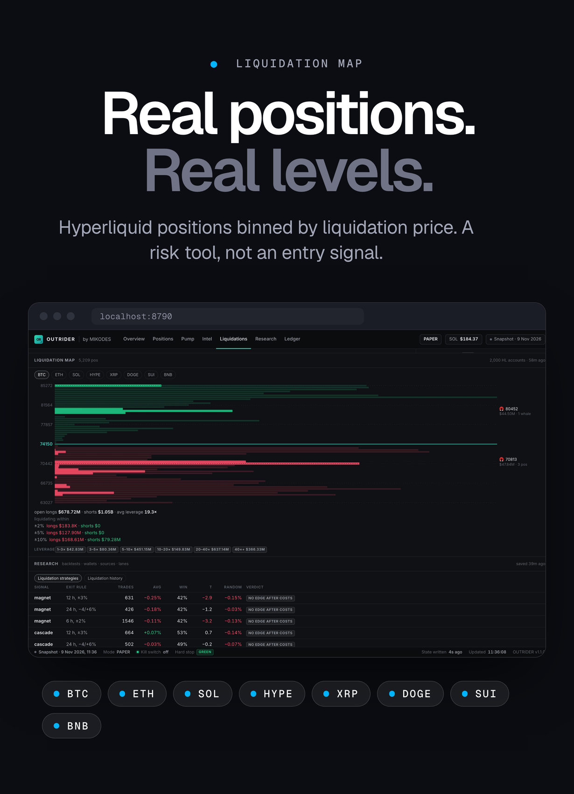
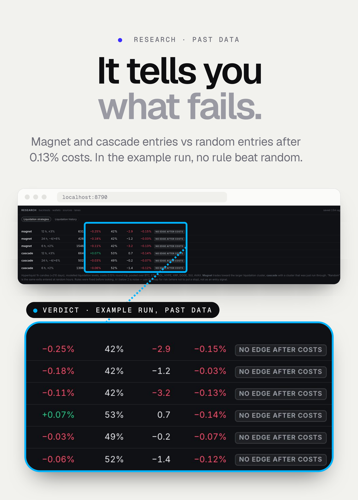
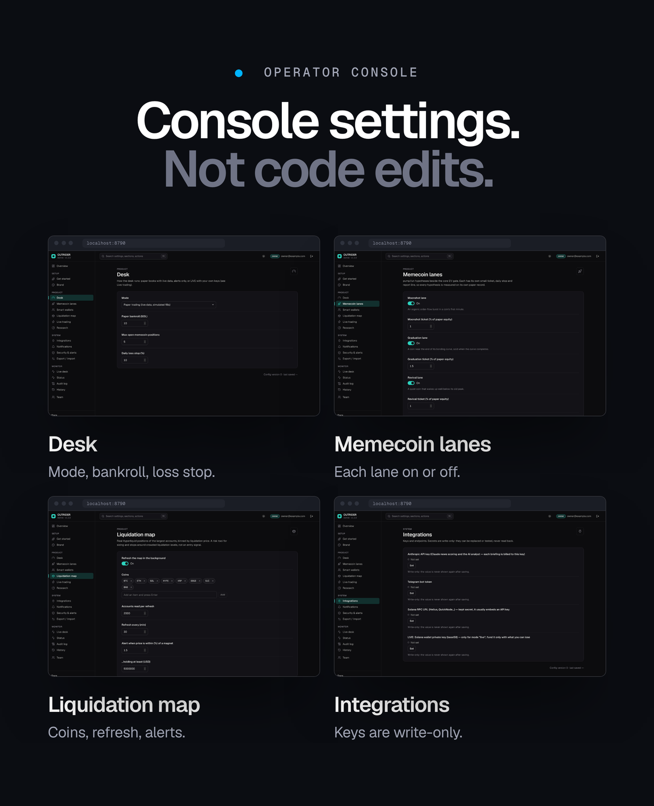

  

<h1 align="center">Outrider</h1>

  <b>Memecoin research desk with paper and live trading (Node.js).</b>

  <a href="https://outrider-demo.mikodes.com/"><b>▶ Live demo</b></a> ·
  <a href="https://outrider.mikodes.com/docs/"><b>Docs</b></a> ·
  <a href="https://outrider.mikodes.com/"><b>Website</b></a> ·
  <a href="https://store.mikodes.com/p/outrider/"><b>Get the full source code</b></a>

  
  

  

> **This repository is a showcase.** It holds screenshots, documentation pointers and a real excerpt
> from the code. The full application is sold as source code at
> **[store.mikodes.com/p/outrider](https://store.mikodes.com/p/outrider/)**: one payment, instant ZIP download, free setup help.

---

## What it is

A self-hosted research desk that watches new tokens, scores them, runs strategies on live data in paper or alert mode first, and writes a regular AI market briefing from the desk's own numbers.

## Screens

 

 

 

## Features

- **Paper, alert or live mode: live trades pump.fun with your keys**: Run every strategy on live data without risking funds or handing over a key.
- **AI analyst: Claude briefing every few hours**: A second opinion written from the desk's own numbers, on the dashboard and via Telegram /brief.
- **pump.fun real-time agent with EV gate, fractional Kelly and bonding-curve fills**: Only takes paper trades whose expected value clears costs.
- **Four extra pump.fun lanes: moonshot, graduation, revival, smart-money consensus**: Each hypothesis runs with its own stake, stops and report line.
- **Exit-quality grades after every pump.fun close**: Tells you whether the exits or the entries lose money.
- **Attested sha256 journal with `verify`**: Proves the paper record was not edited, reordered or truncated.
- **Per-trade cost accounting**: Paper results are not flattered.
- **Wallet book from the on-chain stream: realised PnL, bot/sniper/dust/creator/listed-insider flags,…**: A smart-wallet list that is tested, not assumed.
- **Wallet candidate sources with per-source scorecard**: Import any leaderboard and see whether its wallets actually trade well.
- **GeckoTerminal collector for post-graduation Solana pools**: Wallet data beyond the pump.fun curve.
- **FOMO fee-wallet trade reader and leaderboard**: A FOMO trader leaderboard without a login.
- **Real Hyperliquid liquidation map + LiqWatcher Telegram alerts**: See where real leveraged positions liquidate.

## How it works

A technical case study of the architecture, one end-to-end flow, the key engineering decisions and how you would build something like this: **[docs/HOW-IT-WORKS.md](docs/HOW-IT-WORKS.md)**.

## A look at the code

Real excerpts from the source, shown for illustration:

- **Drawdown protections** ([`snippets/protections.mjs`](snippets/protections.mjs)): A stop-out guard and a tiered equity hard stop for an automated desk. It smooths out single price wicks and latches at the top tier until a human resumes trading.
- **Expected value and Kelly stake** ([`snippets/ev-and-kelly.mjs`](snippets/ev-and-kelly.mjs)): The entry decision as pure maths: expected value after fees, slippage, price impact and failed transactions, a fractional-Kelly stake, and a loop that halves the stake until the EV clears the bar or declines.
- **Hash-chained journal** ([`snippets/attested-journal.mjs`](snippets/attested-journal.mjs)): Each journal row carries a hash of the previous hash plus the row, so editing, inserting, removing or reordering a row is detectable by anyone with the file.

## Requirements (full version)

- Node.js >= 22
- `npm ci` then `npm run build`
- One long-running process on a machine with a disk: VPS/container via docker compose, or PM2
- ADMIN_SECRET_KEY recommended on a server
- Recommended: a private Solana RPC/WebSocket
- Optional: ANTHROPIC_API_KEY

Not included: Live trading beyond pump.fun in the core: Hyperliquid live trading belongs to the optional perps module; Any profit or edge. The Research pane and `outrider research` show the buyer's own measurements on their own data; Third-party subscriptions: private Solana RPC, Anthropic API, TypeSafe Jev access, Telegram bot; Hosting, domain, TLS/reverse proxy for the dashboard/admin; Pre-recorded data: the buyer records their own pump.fun stream and wallet data.

## Get the full source code

  

One payment, full licence, instant ZIP download and free setup help.
Questions: [mikodes.com/support](https://mikodes.com/support).

---

  Made by <a href="https://mikodes.com"><b>MIKODES</b></a> · <a href="https://github.com/Mikodesteam">more projects</a>

