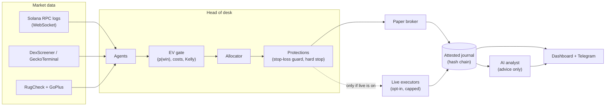

# How Outrider works

A case study of a self-hosted crypto trading desk written in plain Node.js: a set of specialised agents
that read market data, a head-of-desk that enforces limits, a paper broker, an optional live mode, a
web dashboard and a Telegram bot. It is written from the real code; short verbatim excerpts are in
[`../snippets/`](../snippets/).

## The problem and who it is for

Automated trading tools tend to fail in one of two ways: they show a profitable-looking backtest that
ignores costs, or they trade with real money before anyone has measured whether the rules work.
Outrider is built around the opposite order. It starts in **paper** mode, books every trade with its costs
(fees, slippage, price impact, tips and failed transactions), writes a tamper-evident journal, and shows the
operator their own measurements before any real order is possible. It is for developers and small teams who
want a transparent research and execution desk for memecoin launches on pump.fun and, with optional
modules, for perpetual futures, funding, prediction markets and wallet analysis. It makes no claim about
profit; the Research pane displays what the buyer's own data says.

## Architecture

A single long-running Node.js process (Node 22), with SQLite via `better-sqlite3` and a small Hono web
server. There is no framework around the agents: each is a class with a `step` or event handler, and the
desk wires them together.

| Part | What it does |
| --- | --- |
| Agents (`src/agents`) | Scout, risk and security checks, news, whales, shill counter, pump.fun real-time agent, exit logic and the optional perps, funding, Polymarket, copy and macro books. |
| Head of desk (`src/desk.mjs`) | Routes data between agents, enforces limits, runs the EV gate and the protections. It never trades on its own judgement. |
| Library (`src/lib`) | Pure modules: EV and Kelly, protections, allocator, statistics, attested journal, wallet book, liquidation map, calls ledger. |
| Lab (`src/lab`) | Replay, walk-forward sweep, evolution with deflated Sharpe, the research job. |
| Live (`src/live`) | Executors for pump.fun (Solana) and Hyperliquid, disabled unless explicitly configured. |
| Web (`src/web`) and Telegram bot | A dashboard for desktop and phone and an owner-only bot. |
| Operator console | Settings and brand through the MIKODES Admin Kit, applied to the running desk. |

## One flow end to end: a pump.fun entry, from log line to journal row

1. **An event arrives.** The pump.fun agent subscribes to the Solana RPC over a WebSocket for the program's
   logs. A new token or a trade event becomes a candidate with its bonding-curve state.
2. **The security agent screens it.** Second-opinion checks from free public APIs run fail-closed: an unknown
   answer never passes, and a check that errors is never read as safe. Partial answers (a missing field, an
   empty status) are counted as "unknown", not as "fine".
3. **Features are built.** Inputs such as buy pressure, volume against liquidity, freshness, momentum, whale
   count, mentions and rug risk are scaled to the range 0 to 1. Every input is coerced to a finite number, so a
   half-filled API response cannot produce a NaN probability.
4. **A probability is estimated.** A logistic model turns the features into `p(win)`. Before the journal has
   enough closed trades it uses a deliberately conservative prior (the code says: a prior is an opinion, not
   evidence); afterwards `outrider fit` refits the weights from the journal.
5. **The EV gate runs** (see [`ev-and-kelly.mjs`](../snippets/ev-and-kelly.mjs)). Expected value is computed
   per unit staked after fees, slippage, price impact on both sides, tips and failed transactions, plus the
   rug risk. A fractional-Kelly stake is capped by a per-token maximum. If the EV is below the bar, the
   stake is halved and re-checked (price impact grows with size), up to six times, then the trade is declined.
6. **Limits apply.** The allocator scales the stake by book (probation, proven or paused by a probabilistic
   Sharpe test, with risk parity). Total exposure must fit under a percentage of equity, lane limits apply,
   and the protections must be green (see [`protections.mjs`](../snippets/protections.mjs)).
7. **Paper or live.** In paper mode the broker fills against the bonding curve model. In live mode the order
   is built by an executor that, by default, only signs and simulates without sending (dry run).
8. **The row is written to the attested journal** with a hash of the previous row (see
   [`attested-journal.mjs`](../snippets/attested-journal.mjs)). The dashboard, the Telegram bot and the AI
   analyst read from it.
9. **Exits run before entries** in each cycle, and the exit is graded afterwards so the operator can see
   whether exits were early or late.

## Key engineering decisions

### 1. Paper first, live behind several explicit gates

- **Chosen:** the default mode is paper. Live mode needs the mode set, an exact confirmation sentence in the
  config, at least one venue enabled, keys in the environment, per-trade caps, and a private RPC; even then
  it starts as a dry run.
- **Alternative:** a single "live" toggle.
- **Why:** each gate removes one way to lose money by accident. The check function returns a list of reasons
  live mode cannot start and never prints key material.

### 2. One EV formula with every cost, shared by paper and live

- **Chosen:** a pure module computes expected value after all costs and is logged with the trade.
- **Alternative:** tune each agent's rules separately.
- **Why:** if paper and live use the same function, paper results mean something. If costs are left out, paper
  results are flattering and wrong. Unknown liquidity is treated as the 100 % worst-case impact so the model
  never flatters a trade.

### 3. A hash-chained journal instead of a plain log

- **Chosen:** each row carries `sha256(previous hash + row)`. A `verify` command checks the chain.
- **Alternative:** a database table or a plain file.
- **Why:** it makes quiet after-the-fact edits (a deleted loser, a backdated winner) detectable. The code is
  honest about the limit: it is evidence, not proof, because whoever runs the desk could run modified code.

### 4. Protections that latch

- **Chosen:** a stop-loss guard locks new entries after a run of stop-outs. A tiered hard stop tracks
  drawdown from the equity peak with a smoothed score and escalates green, yellow, orange, red. Red stays
  latched until a human removes a file.
- **Alternative:** automatic resume after a cooldown.
- **Why:** a drawdown limit that resets itself is a pause, not a limit. Resuming needs a human decision,
  and the peak is re-based on resume so the same drawdown does not retrigger instantly.

### 5. Test the idea out of sample, and say how many ideas you tried

- **Chosen:** walk-forward sweeps, a wallet-persistence test with a 70/30 split, and an evolution lab that
  reports a deflated Sharpe ratio and a probability of backtest overfitting.
- **Alternative:** report the best in-sample result.
- **Why:** the more variants you try, the better the best one looks by chance. The statistics modules
  exist to correct for that.

## Security and safety measures that exist in the code

- **Paper by default;** live needs an exact confirmation sentence, keys in the environment, caps per trade and a
  failure counter that sets the kill switch after repeated failures (no new entries, exits keep running).
- **Hyperliquid uses an agent key that cannot withdraw,** according to the live-mode notes in the code.
- **Kill switch file** (`data/STOP`) and a red hard stop that latches.
- **Fail-closed token screening** with unknown answers counted as bad.
- **Defensive numerics.** Every number that reaches cash, equity, stakes or the equity history is checked;
  bad prices are ignored rather than booked; non-finite model weights fall back to the prior.
- **Cycle isolation.** The main cycle never throws, each stage is isolated, state is saved in a `finally`,
  and one bad position or agent does not stop the others.
- **Dashboard guard.** The web server refuses to listen on a non-loopback host without an access token.
- **Owner-only Telegram bot.**
- **AI analyst is advice only.** It receives a small factual snapshot (no keys, only short wallet prefixes),
  returns structured output with server-side fallbacks, and never changes a setting or trades.
- **Demo data is labelled** as sample data in the static demo exporter.

## Testing approach

- A large offline test suite (no network) covers the pure modules, the agents against fixtures and the
  desk's invariants.
- Pure modules take the clock as a parameter, so tests control time.
- `outrider doctor` checks every data source, the WebSocket, keys and configuration on a real install.
- `npm run check` runs the type checker, the linter, the formatter check and the tests.

## How you would build something like this

1. **Build the measuring instrument before the strategy.** A journal with every cost recorded per trade, and
   a way to prove the journal was not edited.
2. **Write the decision as a pure function** of features and costs, and log its inputs with each trade.
3. **Add the paper broker with honest fills** (price impact from pool depth, fees, tips, failed
   transactions). If it is not pessimistic, the numbers are noise.
4. **Add the protections and the kill switch before the second strategy,** and make the worst tier latch.
5. **Add data agents one at a time,** each fail-closed and each tested against recorded fixtures.
6. **Add research tooling:** replay of recorded data, walk-forward splits and statistics that account for the
   number of trials.
7. **Only then add live execution,** behind a confirmation, caps, a dry-run default and a failure counter.
8. **Last, the surfaces:** a dashboard and a bot that read from the journal and never bypass the desk.

## Deployment and customization

- **Run it:** `npm ci` and `npm run build` (TypeScript compiles the operator console), then start the desk; a
  Dockerfile, a Docker Compose file with a named volume and a PM2 ecosystem file are included. Node.js 22 or
  newer is required.
- **Configure:** modes, lanes, limits and sources in `config.json` or from the operator console; secrets go in
  the environment file, which is loaded on start.
- **Modules:** perps, Polymarket and a third-party model comparison are optional and off by default. An off
  module runs no agents and hides its dashboard sections, console settings and commands.
- **Brand:** name, tagline, accent colour and logo from the console apply to the dashboard and the Telegram bot.
- **Not included:** hosting, a private Solana RPC, third-party API subscriptions, and any guarantee of
  profit. Live trading uses your own keys at your own risk.

Full source code, docs and setup help: https://store.mikodes.com/p/outrider/
